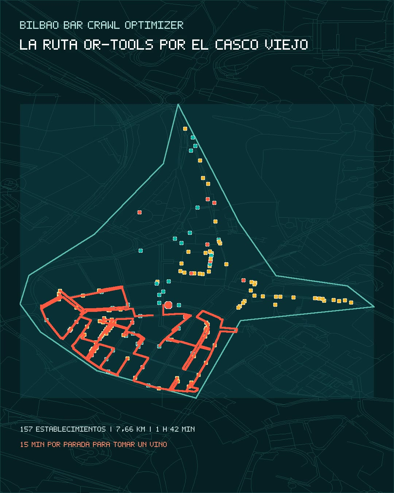

<p align="center">
  
</p>

<h1 align="center">Bilbao Bar Crawl Optimizer</h1>

<p align="center">
  <strong>¿Cuál es la ruta más rápida para visitar todos los bares del Casco Viejo de Bilbao?</strong><br />
  Datos reales · red peatonal · algoritmos de optimización · simulación visual
</p>

<p align="center">
  <a href="https://ebarquin.github.io/bilbao-bar-crawl-optimizer/">Ver demo interactiva</a> ·
  <a href="notebooks/01_experimento_rutas.ipynb">Abrir notebook</a> ·
  <a href="docs/architecture.md">Leer arquitectura</a>
</p>

<p align="center">
  
  
  
</p>

## La idea

Bilbao Bar Crawl Optimizer es una demostración reproducible de optimización de rutas peatonales. El área de estudio se representa como un grafo: los nodos son puntos de la red peatonal y las aristas son calles y conexiones caminables con un coste de distancia.

La ruta debe visitar los 157 establecimientos del sector. Para responder a la pregunta temporal, añadimos una parada estimada de 15 minutos en cada establecimiento, interpretada como el tiempo de tomar un vino. Esa parada es configurable, no es una observación real y no modifica la geometría de la animación.

> El resultado es la mejor solución encontrada bajo este modelo y estos datos. No se presenta como una demostración del óptimo global.

## Resultado actual

Escenario: recorrido abierto, salida fija desde Plaza Nueva y final libre.

| Método | Distancia | Caminando | Tiempo total* | Mejora** |
| --- | ---: | ---: | ---: | ---: |
| OR-Tools | **7,66 km** | **1 h 42 min** | **40 h 57 min** | **86,18 %** |
| 2-opt | 8,13 km | 1 h 48 min | 41 h 03 min | 85,32 % |
| Nearest Neighbor multi-start | 8,79 km | 1 h 57 min | 41 h 12 min | 84,13 % |
| Nearest Neighbor | 8,91 km | 1 h 59 min | 41 h 14 min | 83,92 % |
| Random, mejor de 10 | 53,43 km | 11 h 52 min | 51 h 07 min | 3,53 % |

\* Incluye 157 paradas × 15 minutos. ** Mejora frente a la media de las ejecuciones aleatorias.

## Vídeo para LinkedIn

La demostración también está preparada como vídeo vertical de 20 segundos. Haz clic en la portada para abrir el MP4:

<p align="center">
  <a href="media/bilbao-bar-crawl-linkedin.mp4">
    
  </a>
</p>

El vídeo utiliza la ruta OR-Tools precalculada, la red peatonal real y los mismos resultados que la aplicación.

## Datos y modelo

- **157 establecimientos**: 105 pubs, 36 cafeterías y 16 bares según la extracción activa.
- **Red peatonal**: 5.258 nodos y 14.526 aristas procedentes de OpenStreetMap.
- **Accesos**: un nodo virtual independiente para cada establecimiento, proyectado sobre la arista peatonal más cercana.
- **Matriz**: 24.649 pares ordenados, todos alcanzables en el artefacto actual.
- **Velocidad de referencia**: 4,5 km/h.
- **Parada configurable**: 15 minutos por establecimiento.

El dataset es suficientemente realista para probar y comparar algoritmos, pero no pretende ser un inventario exhaustivo de la oferta hostelera de Bilbao.

## Ver la aplicación localmente

```bash
python3 -m http.server 8000 --directory .
```

Abre <http://localhost:8000/dist/>. La aplicación consume artefactos locales y no necesita un servidor de cálculo para mostrar la demo.

## Reproducir el pipeline

Instalar dependencias:

```bash
uv sync
```

Regenerar red, matriz, optimizaciones y simulaciones:

```bash
PATH=/opt/homebrew/bin:$PATH .venv/bin/python scripts/build_pedestrian_network.py --source osm-map
PATH=/opt/homebrew/bin:$PATH .venv/bin/python scripts/split_venue_nodes.py
PATH=/opt/homebrew/bin:$PATH .venv/bin/python scripts/build_distance_matrix.py
PATH=/opt/homebrew/bin:$PATH .venv/bin/python scripts/compare_optimizers.py
PATH=/opt/homebrew/bin:$PATH .venv/bin/python scripts/build_route_simulations.py
```

Cada etapa deja sus artefactos en `data/processed/`. La aplicación y el notebook leen esos artefactos; no duplican el cálculo.

## Qué comparar

El experimento utiliza la misma matriz de costes para todos los métodos:

1. **Random**: referencia reproducible con diez semillas.
2. **Nearest Neighbor**: elige en cada paso el establecimiento más cercano no visitado.
3. **Nearest Neighbor multi-start**: repite la heurística con distintos puntos iniciales.
4. **2-opt**: mejora una ruta existente invirtiendo tramos cuando reduce su coste.
5. **OR-Tools**: solver adicional para el escenario abierto con final libre.

## Documentación

- [Notebook de cálculos y decisiones](notebooks/01_experimento_rutas.ipynb)
- [Arquitectura](docs/architecture.md)
- [Plan de Fase 0](docs/phase-0-plan.md)
- [ADRs](docs/adrs/)
- [Scripts reproducibles](scripts/)
- [Datos activos](data/)

## Limitaciones y alcance

Los establecimientos y la red proceden de OpenStreetMap y pueden contener nombres incompletos, centros aproximados o conexiones faltantes. En este proyecto esas limitaciones forman parte del contexto de la prueba: el objetivo es estudiar el comportamiento de los algoritmos sobre un problema geográfico realista, no certificar un inventario comercial.

Los tiempos no incluyen horarios de apertura, esperas, pausas adicionales ni observaciones reales de consumo. La animación muestra el recorrido peatonal y no representa la duración de las paradas.

## Licencia y atribución

Los datos geográficos utilizados proceden de OpenStreetMap contributors y están disponibles bajo la licencia [ODbL](https://www.openstreetmap.org/copyright). Las consultas y artefactos se conservan localmente para limitar peticiones externas y facilitar la reproducción.
