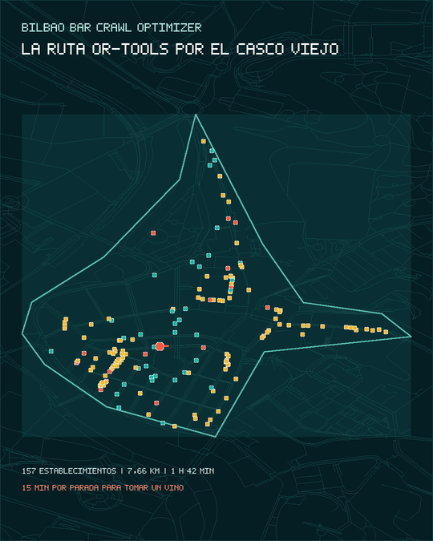

<p align="center">
  
</p>

<h1 align="center">Bilbao Bar Crawl Optimizer</h1>

<p align="center">
  <strong>What is the fastest route to visit every bar in Bilbao's Old Town?</strong><br />
  Real data · pedestrian network · optimization algorithms · visual simulation
</p>

<p align="center">
  <a href="https://ebarquin.github.io/bilbao-bar-crawl-optimizer/">Open the interactive demo</a> ·
  <a href="notebooks/01_experimento_rutas.ipynb">Open the notebook</a> ·
  <a href="docs/architecture.md">Read the architecture</a>
</p>

<p align="center">
  
  
  
</p>

## The idea

Bilbao Bar Crawl Optimizer is a reproducible demonstration of pedestrian route optimization. The study area is represented as a graph: nodes are points on the pedestrian network, and edges are walkable streets and connections with a distance cost.

The route must visit all 157 establishments in the study area. To answer the time question, the simulation adds an estimated 15-minute stop at every establishment, representing the time needed to have a glass of wine. This stop duration is configurable, is not an observed measurement, and does not change the animation geometry.

> The result is the best solution found under this model and dataset. It is not presented as a proof of global optimality.

## Current result

Scenario: open route, fixed start at Plaza Nueva, free final destination.

| Method | Distance | Walking | Total time* | Improvement** |
| --- | ---: | ---: | ---: | ---: |
| OR-Tools | **7.66 km** | **1 h 42 min** | **40 h 57 min** | **86.18%** |
| 2-opt | 8.13 km | 1 h 48 min | 41 h 03 min | 85.32% |
| Nearest Neighbor multi-start | 8.79 km | 1 h 57 min | 41 h 12 min | 84.13% |
| Nearest Neighbor | 8.91 km | 1 h 59 min | 41 h 14 min | 83.92% |
| Random, best of 10 | 53.43 km | 11 h 52 min | 51 h 07 min | 3.53% |

\* Includes 157 stops × 15 minutes. ** Improvement compared with the mean random run.

## LinkedIn video

The project also includes a 20-second vertical video for LinkedIn. The preview animates directly on GitHub; click it to open or download the MP4:

<p align="center">
  <a href="media/bilbao-bar-crawl-linkedin.mp4">
    
  </a>
</p>

The video uses the precalculated OR-Tools route, the real pedestrian graph, and the same results shown in the web application.

## Data and model

- **157 establishments**: 105 pubs, 36 cafés, and 16 bars in the active extraction.
- **Pedestrian network**: 5,258 nodes and 14,526 edges sourced from OpenStreetMap.
- **Access model**: one independent virtual node per establishment, projected onto the nearest pedestrian edge.
- **Distance matrix**: 24,649 ordered pairs, all reachable in the current artifact.
- **Reference walking speed**: 4.5 km/h.
- **Configurable stop**: 15 minutes per establishment.

The dataset is realistic enough to test and compare algorithms, but it is not intended to be an exhaustive inventory of Bilbao's hospitality venues.

## Run the application locally

```bash
python3 -m http.server 8000 --directory .
```

Open <http://localhost:8000/dist/>. The application consumes local artifacts and does not require a calculation server to display the demo.

## Reproduce the pipeline

Install dependencies:

```bash
uv sync
```

Regenerate the network, matrix, optimizations, and simulations:

```bash
PATH=/opt/homebrew/bin:$PATH .venv/bin/python scripts/build_pedestrian_network.py --source osm-map
PATH=/opt/homebrew/bin:$PATH .venv/bin/python scripts/split_venue_nodes.py
PATH=/opt/homebrew/bin:$PATH .venv/bin/python scripts/build_distance_matrix.py
PATH=/opt/homebrew/bin:$PATH .venv/bin/python scripts/compare_optimizers.py
PATH=/opt/homebrew/bin:$PATH .venv/bin/python scripts/build_route_simulations.py
```

Each stage writes its artifacts to `data/processed/`. The application and notebook read those artifacts rather than duplicating the calculation.

## Algorithms compared

All methods use the same cached cost matrix:

1. **Random**: reproducible reference with ten seeds.
2. **Nearest Neighbor**: always chooses the closest unvisited establishment.
3. **Nearest Neighbor multi-start**: runs the heuristic from multiple initial destinations.
4. **2-opt**: improves an existing route by reversing segments when the cost decreases.
5. **OR-Tools**: an additional solver for the open-route, free-end scenario.

## Documentation

- [Calculation and decision notebook](notebooks/01_experimento_rutas.ipynb)
- [Architecture](docs/architecture.md)
- [Phase 0 plan](docs/phase-0-plan.md)
- [Architecture decision records](docs/adrs/)
- [Reproducible scripts](scripts/)
- [Active data](data/)

## Scope and limitations

Establishments and pedestrian network data come from OpenStreetMap and may contain incomplete names, approximate centers, or missing connections. In this project those limitations are part of the experiment: the goal is to study algorithm behavior on a realistic geographic problem, not to certify a commercial inventory.

Times do not include opening hours, waiting, additional breaks, or observed consumption times. The animation shows the pedestrian route and does not represent the duration of stops.

## License and attribution

Geographic data comes from OpenStreetMap contributors and is available under the [ODbL](https://www.openstreetmap.org/copyright). Queries and artifacts are stored locally to limit external requests and support reproducibility.
